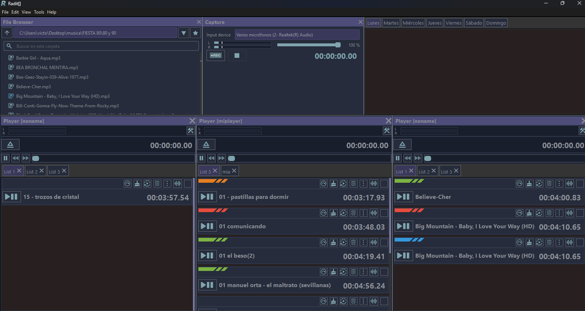
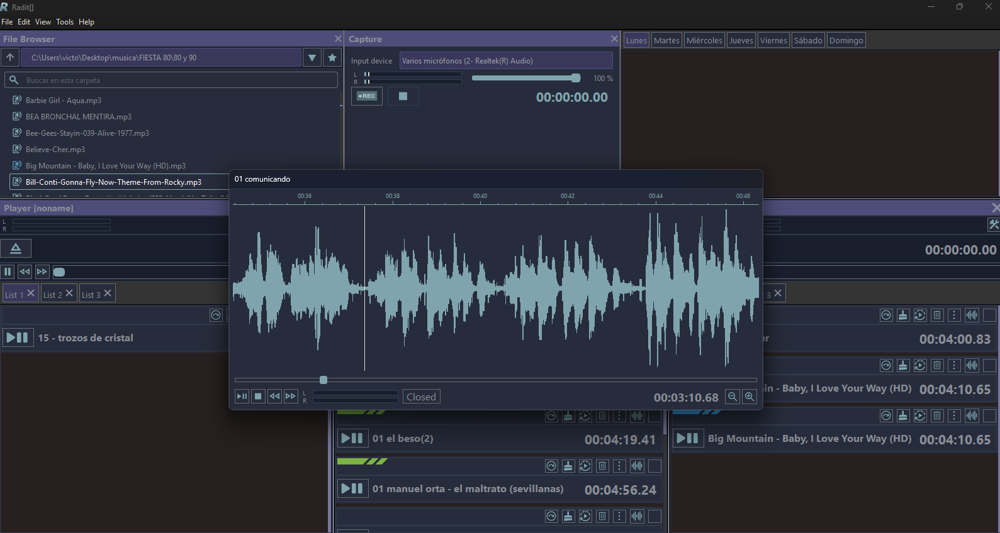
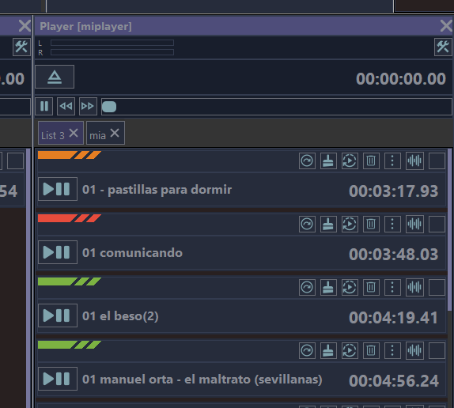
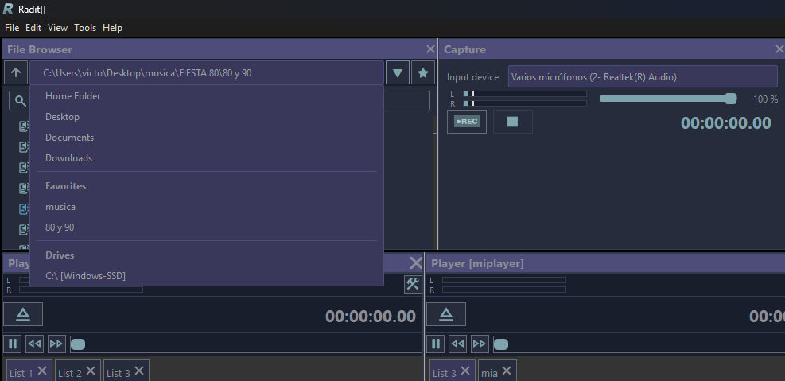

# Radit

Open-source radio automation software.

[Website](https://www.radit.org/) · [Development downloads](https://github.com/valgaba/radit/releases) · [Report an issue](https://github.com/valgaba/radit/issues)

## Development build for Windows

**These are development builds, currently in testing. They may contain bugs and incomplete features.**

1. Download the [current Windows build](https://github.com/valgaba/radit/releases/download/radit-1.0.0/radit_1_0_0.zip) (`radit_1_0_0.zip`).
2. Extract the ZIP; it creates a `radit_1_0_0` folder containing the program and its subfolders.
3. Run `radit_1_0_0/radit.exe`.

The package is portable and intended for 64-bit Windows. Qt Creator is not required. Keep the included libraries and plugins alongside the executable. The package includes only the main Radit executable; experimental `radit-*.exe` builds are excluded. `ffmpeg/ffmpeg.exe` is an internal audio dependency. Keep `locution/es_latino.zip` in place for spoken MeteoClock announcements.

Audio devices may need to be selected in the player options on your computer.

## Build from source: FFmpeg

The source repository keeps runtime folders under `out/bin/`: `out/bin/locution/es_latino.zip`, `out/bin/capture/` and `out/bin/ffmpeg/`. These are beside the executable in the project output. FFmpeg binaries are downloaded separately; copy `ffmpeg.exe` and its DLLs into `out/bin/ffmpeg/`. See [`out/bin/ffmpeg/README.md`](out/bin/ffmpeg/README.md). Do not use Windows binaries for Linux builds. The `out/bin/capture/` placeholder is empty; recordings created while running Radit stay local.

## Screenshots

Actual software screenshots supplied by the project maintainer.

### Main interface

### Waveform view

### Playlists

### File browser

## Feedback and improvements

Follow the [release notes](https://github.com/valgaba/radit/releases) for updates. To report a problem, open an [issue](https://github.com/valgaba/radit/issues) with your Windows version, the development build you used, steps to reproduce the problem and a screenshot if useful.

## Support the project

[Donate through PayPal](https://www.paypal.com/donate?hosted_button_id=LPGEM5WJTL5HW)

## License

Radit is distributed under [GPL-3.0](LICENSE). Bundled third-party components retain their respective licenses.

---

## Español

Radit es un proyecto de software libre para la automatización de emisoras de radio.

**Las descargas son versiones de desarrollo en fase de pruebas. Pueden contener errores y funciones incompletas.**

El repositorio guarda los recursos de ejecución dentro de `out/bin/`: `out/bin/locution/es_latino.zip`, `out/bin/capture/` y `out/bin/ffmpeg/`. Quedan junto al ejecutable en la carpeta de salida del proyecto. FFmpeg se descarga por separado; en Windows, copia `ffmpeg.exe` y sus DLL dentro de `out/bin/ffmpeg/`. Consulta [`out/bin/ffmpeg/README.md`](out/bin/ffmpeg/README.md). No uses binarios de Windows en Linux. `out/bin/capture/` se incluye vacía; las grabaciones que genere Radit permanecen en el equipo.

Descarga la [versión actual para Windows](https://github.com/valgaba/radit/releases/download/radit-1.0.0/radit_1_0_0.zip) (`radit_1_0_0.zip`), extrae el ZIP; se creará la carpeta `radit_1_0_0` con el programa y sus subcarpetas. Ejecuta `radit_1_0_0/radit.exe`. Conserva las bibliotecas y subcarpetas incluidas, especialmente `locution/es_latino.zip` para la locución de MeteoClock. El paquete es portable para Windows de 64 bits y no requiere Qt Creator. Selecciona los dispositivos de audio desde las opciones del reproductor si es necesario.

Puedes seguir las mejoras en las notas de cada versión y comunicar problemas en [Issues](https://github.com/valgaba/radit/issues).

[Web en español](https://www.radit.org/es.html) · [Anterior proyecto Radit](https://www.radit.org/sources/) · [Donar al proyecto](https://www.paypal.com/donate?hosted_button_id=LPGEM5WJTL5HW)
